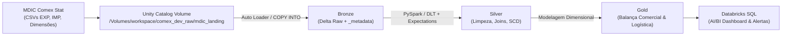

# Comex Lakehouse — Databricks Data Engineering (MDIC / Comex Stat)

Projeto prático de **Engenharia de Dados ponta a ponta no Databricks**, construído em formato **Build in Public** (7 episódios) sobre a base pública bruta de **Comércio Exterior do Brasil (MDIC — Comex Stat)**, mapeado 100% para o exame **Databricks Certified Data Engineer Associate**.

---

## Arquitetura do Projeto



---

## Estrutura do Repositório (Databricks Asset Bundles)

```text
databricks-comex-lakehouse/
├── databricks.yml                          # Definição do Bundle, variáveis e targets (dev/prod)
├── resources/
│   └── setup_unity_catalog_job.yml         # Lakeflow Job Serverless para provisionar Unity Catalog
├── src/
│   ├── setup/
│   │   └── 00_setup_unity_catalog.py       # Notebook idempotente: schemas Medallion + Volume
│   ├── bronze/                             # Episódio 2: Ingestão Incremental (Auto Loader / COPY INTO)
│   ├── silver/                             # Episódios 4 e 5: Transformações + DLT Expectations
│   └── gold/                               # Episódio 6: Tabelas Analíticas + Databricks SQL
└── docs/
    └── linkedin/                           # Roteiros da série Build in Public no LinkedIn
```

---

## Trilha dos Episódios (Certificação Associate)

| Episódio | Tema | Domínios da Prova | Status |
| :---: | :--- | :--- | :---: |
| **01** | Setup Profissional: Databricks CLI, OAuth, DABs & Unity Catalog | Lakehouse Platform, Production Pipelines, Governance | Em andamento |
| **02** | Ingestão Incremental na Bronze (Auto Loader vs `COPY INTO`) | Incremental Data Processing, ELT | Planejado |
| **03** | Deep Dive no Delta Lake (ACID, Time Travel, `MERGE`, Liquid Clustering) | Lakehouse Platform | Planejado |
| **04** | Camada Silver com PySpark & Spark SQL (Joins, Views, UDFs) | ELT with Spark SQL & Python | Planejado |
| **05** | Pipelines Declarativos (DLT) & Data Quality (*Expectations*) | Incremental Data Processing | Planejado |
| **06** | Camada Gold, Databricks SQL, AI/BI Dashboard & Alertas | Governance & Databricks SQL | Planejado |
| **07** | Orquestração Multi-Task, Linhagem no Unity Catalog & CI/CD | Production Pipelines & Governance | Planejado |

---

## Como Executar o Episódio 1 (Setup do Zero)

### Pré-requisitos
- Conta no **Databricks Free Edition** (Serverless + Unity Catalog)
- `git`, `python3 (>=3.11)` e `databricks` CLI (`>= v0.220` / `v1.x`)

### 1. Autenticação OAuth U2M (sem tokens hardcoded)
```bash
databricks auth login \
  --host https://dbc-bc85b8d9-abfd.cloud.databricks.com \
  --profile comex-free
```

Verifique a conexão:
```bash
databricks current-user me --profile comex-free
```

### 2. Validar o Databricks Asset Bundle (DABs)
```bash
databricks bundle validate -t dev
```

### 3. Fazer o Deploy do Bundle para o Workspace
```bash
databricks bundle deploy -t dev
```

### 4. Executar o Job Serverless de Provisionamento do Unity Catalog
```bash
databricks bundle run setup_unity_catalog_job -t dev
```

Após a execução, verifique no **Catalog Explorer** do Databricks os schemas criados em `workspace`:
- `workspace.comex_dev_raw` (com o Managed Volume `mdic_landing`)
- `workspace.comex_dev_bronze`
- `workspace.comex_dev_silver`
- `workspace.comex_dev_gold`

---

## Fonte dos Dados
- **MDIC — Comex Stat (Base de Dados Bruta):** https://www.gov.br/mdic/pt-br/assuntos/comercio-exterior/estatisticas/base-de-dados-bruta
